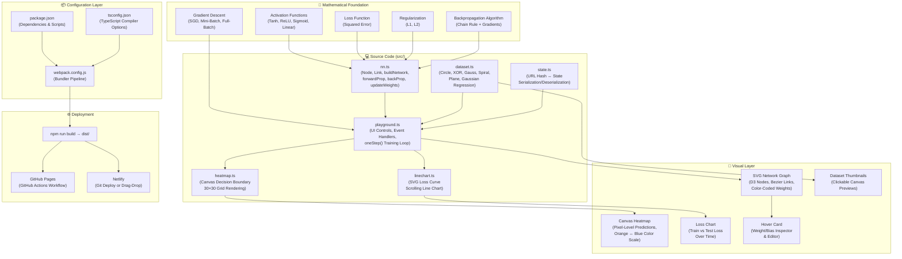

# 🏛️ Deep Playground — System Architecture & Mental Model

> **Project:** Deep Playground (Interactive Neural Network Visualization)  
> **Source of Truth:** `SRS.md` v4.0 (§1–§59)  
> **Reference Task:** `ROADMAP.md` Phase 12 (P12.19)

---

## 1. Executive Summary & Vision

Deep Playground is an educational, fully client-side artificial neural network simulator. It requires zero backend servers, zero database instances, and zero external computational resources. Everything — dataset generation, matrix operations, forward propagation, backpropagation, decision boundary rasterization, and loss curve rendering — runs inside the browser's JavaScript execution thread.

The core architectural priorities are:
1. **Mathematical Accuracy**: Pure zero-dependency neural network math implemented from first principles.
2. **Deterministic Reproducibility**: Seeded pseudo-random generation ensuring byte-for-byte reproducibility across runs and shareable URL hashes.
3. **Responsive Visual Feedback**: Real-time D3 SVG network graph rendering, canvas pixel-buffer decision boundary updates, and continuous loss curves synchronized via `requestAnimationFrame`.
4. **Pedagogical Clarity**: Direct correspondence between theoretical formulas ($\sigma, \delta, \frac{\partial E}{\partial w}$) and clean TypeScript code.

---

## 2. The Complete Mental Model (SRS §59)

The following mental model diagram captures the unified architecture across configuration, mathematics, source code, visual components, and deployment:



---

## 3. Layered Architectural Decomposition

### 3.1 Layer 1: Configuration & Build Toolchain
- **`package.json`**: Manages runtime dependencies (`d3@^3.5.17`, `seedrandom@^2.4.2`), dev dependencies (`typescript`, `webpack`, `ts-loader`, `mini-css-extract-plugin`), and execution scripts.
- **`tsconfig.json`**: Configures the TypeScript compiler (`target: es5`, `module: commonjs`, `declaration: true`, strict type emission).
- **`webpack.config.js`**: Bundles TypeScript and CSS into `dist/bundle.js` and `dist/bundle.css`, with `HtmlWebpackPlugin` generating `dist/index.html`.

### 3.2 Layer 2: Mathematical Core (`src/nn.ts`)
The mathematical engine models the neural network explicitly as an object graph rather than a black-box tensor:
- **`Node`**: Represents a single neuron. Stores pre-activation $z$, activated output $a$, local gradients $\delta = \frac{\partial E}{\partial z}$, and accumulated input derivatives.
- **`Link`**: Represents a weighted connection $w_{ji}$. Stores weight value, gradient accumulator $\sum \frac{\partial E}{\partial w}$, regularization penalty, and pruning state (`isDead`).
- **`buildNetwork(shape, act, outAct, reg, inputIds, initZero)`**: Constructs the 2D node matrix `Node[][]` and connects adjacent layers.
- **`forwardProp(network, inputs)`**: Propagates inputs forward through layers evaluating $z_i^{(L)} = b_i^{(L)} + \sum w_{ji} a_j^{(L-1)}$ and $a_i^{(L)} = \sigma(z_i^{(L)})$.
- **`backProp(network, target, errorFunc)`**: Evaluates output error derivatives and propagates $\delta$ backward using the chain rule.
- **`updateWeights(network, lr, regRate)`**: Applies averaged batch gradients, updates biases and weights, and executes L1 zero-crossing link pruning (SRS §43).

### 3.3 Layer 3: Dataset Engine (`src/dataset.ts`)
Generates 2D synthetic datasets mapping $(x, y) \to \text{label}$:
- **Classification Datasets**:
  - `classifyCircleData`: Radial thresholding with concentric positive core and negative outer ring.
  - `classifyXORData`: Quadrant product sign $x \cdot y \ge 0$ with 0.3 axis padding.
  - `classifyTwoGaussData`: Two clusters centered at $(2, 2)$ and $(-2, -2)$ with Box-Muller Gaussian sampling.
  - `classifySpiralData`: Archimedean polar spirals shifted by $\pi$ radians.
- **Regression Datasets**:
  - `regressPlane`: Linear planar target $z = \frac{x + y}{12}$.
  - `regressGaussian`: Multi-modal surface using radial basis functions from 6 center points.
- **Splitting & Randomness**:
  - `normalRandom`: Box-Muller transform with rejection sampling ($\approx 78.5\%$ acceptance rate).
  - `shuffle`: Uniform Fisher-Yates in-place shuffle.
  - `splitData`: Deterministic train/test partition based on user percentage.

### 3.4 Layer 4: State Management & Serialization (`src/state.ts`)
Encapsulates global application state with URL hash synchronization:
- **Registry (`State.PROPS`)**: Declarative metadata registry mapping property names to types (`NUMBER`, `STRING`, `BOOLEAN`, `ARRAY_NUMBER`, `OBJECT`) and lookup dictionaries.
- **`deserializeState()`**: Parses `window.location.hash`, maps values to types, populates fallback defaults, and handles seed initialization.
- **`serialize()`**: Serializes active state properties into a URI hash string and updates `window.location.hash`.

### 3.5 Layer 5: Orchestration & Training Loop (`src/playground.ts`)
Coordinates the application lifecycle and interface state machine:
- **`oneStep()`**: The atomic unit of training:
  1. Extracts a mini-batch of size `state.batchSize` from `trainData`.
  2. Executes `forwardProp` and `backProp` for each sample.
  3. Updates parameters via `updateWeights`.
  4. Evaluates total training and test loss over the full datasets.
  5. Appends losses to `AppendingLineChart`.
  6. Re-renders decision boundary in `HeatMap` and network weights in SVG.
  7. If running, requests next animation frame via `requestAnimationFrame(oneStep)`.
- **Interface State Transitions (SRS §50)**:
  - Non-structural changes (`learningRate`, `regularizationRate`) take effect immediately without resetting weights.
  - Structural changes (dataset, features, network shape, activation) trigger a clean reset and epoch 0 restart.

### 3.6 Layer 6: Visual Renderers
- **`HeatMap` (`src/heatmap.ts`)**: Rasterizes decision boundaries across a $30 \times 30$ grid on an HTML5 canvas over $[-6, 6]^2$ using an orange-to-blue linear color scale (`#f59322` to `#0877bd`). Overlays train points (filled circles) and test points (rings).
- **`AppendingLineChart` (`src/linechart.ts`)**: Real-time scrolling SVG loss chart with independent auto-scaling curves for training loss and test loss.
- **D3 SVG Topology Graph**: Renders neurons, cubic Bezier connection links ($M \dots C \dots$), per-layer $+/-$ neuron controls, and interactive hover cards.

---

## 4. Data Flow Architecture

```
User Action (Click / Slider / Hash)
       │
       ▼
   state.ts (Deserialize / Mutate / Serialize)
       │
       ▼
playground.ts (State Machine §50)
  ├── Dataset Generation (dataset.ts) ──► trainData / testData
  ├── Topology Construction (nn.ts)   ──► Node[][] Graph
  └── oneStep() Loop (requestAnimationFrame)
        │
        ├── nn.forwardProp() & nn.backProp()
        ├── nn.updateWeights()
        │
        ├──► heatmap.ts   (Canvas 30×30 Rasterizer)
        ├──► linechart.ts (SVG Loss History Curves)
        └──► D3 SVG Graph (Dynamic Bezier Links & Nodes)
```

---

## 5. Security Threat Model (SRS §57)

1. **Zero Dynamic Evaluation**: No use of `eval()`, `new Function()`, `innerHTML`, or `document.write()`.
2. **Injection Immunity**: URL hash parameters are strictly validated and parsed against type descriptors; invalid keys or malicious strings are ignored or rejected.
3. **No Network Telemetry**: Deep Playground operates entirely offline once loaded. No cookies, `localStorage`, or external tracking requests are made.
4. **Content Security Policy**: Static hosting headers enforce strict script and style execution limits.

