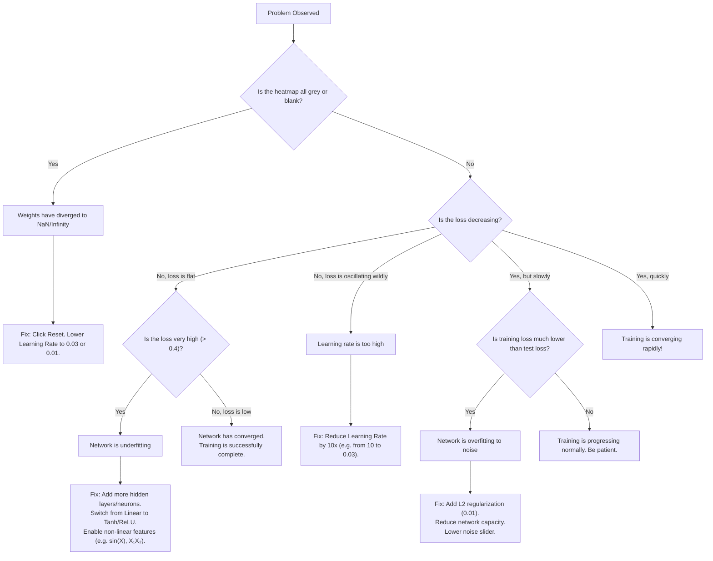

# 🛠️ Troubleshooting Guide & Decision Tree

> **Project:** DeepRoxx  
> **Source of Truth:** `SRS.md` §47.5, §47.6  
> **Roadmap Reference:** Phase 9 (P9.21, P9.22, P9.23)

---

## 1. Troubleshooting Decision Tree (SRS §47.5)

Use the following flowchart to diagnose unexpected behaviors during simulation:

---

## 2. Six Common Troubleshooting Scenarios (SRS §47.6)

### Scenario 1: Circle Dataset Won't Converge
- **Symptom**: Loss remains stuck at ~0.25, and the decision boundary remains a straight line cutting through the circle.
- **Cause**: The network has 0 hidden layers or uses `Linear` activation, which cannot form closed boundaries.
- **Fix**: Add at least 1 hidden layer with 3 or more neurons. Set activation to `Tanh` or `ReLU`.

---

### Scenario 2: Spiral Dataset Has High Test Loss
- **Symptom**: Training loss drops to ~0.01, but test loss remains high (~0.15–0.25), and boundaries show erratic spikes.
- **Cause**: Overfitting. The network is memorizing random noise fluctuations instead of general spiral curvature.
- **Fix**: Enable `L2` regularization with rate `0.001`–`0.01`. Lower dataset noise or increase the Train/Test ratio to 50%+.

---

### Scenario 3: XOR Dataset Shows Random Boundary
- **Symptom**: After 500 epochs, the heatmap looks chaotic and loss oscillates.
- **Cause**: Learning rate is set too high (e.g. `10`), or the network has only 1 hidden neuron.
- **Fix**: Reduce learning rate to `0.03`. Use at least 4 neurons in 1 or 2 hidden layers.

---

### Scenario 4: All Connection Lines Are Transparent
- **Symptom**: The network diagram shows neurons, but all connection links have disappeared.
- **Cause**: L1 regularization rate is set too high (e.g. `0.1` or `1`), causing every weight to cross zero and get pruned (`isDead = true`).
- **Fix**: Reduce regularization rate to `0.001`, or switch to `L2` regularization. Click **Reset** to reinitialize links.

---

### Scenario 5: Regression Output Is Flat
- **Symptom**: In Regression mode (Plane or Gaussian), the heatmap renders a single washed-out uniform color.
- **Cause**: Too few hidden neurons to approximate the target gradient, or the output activation is clamped.
- **Fix**: Add 2–3 hidden layers with 4+ neurons each. In Gaussian regression, enable polynomial features ($X_1^2, X_2^2$).

---

### Scenario 6: Training Is Extremely Slow
- **Symptom**: After 1000 epochs, loss has barely budged.
- **Cause**: Learning rate is set too low (e.g. `0.00001`).
- **Fix**: Increase learning rate to `0.01` or `0.03`. Check that batch size is within `10`–`20`.

